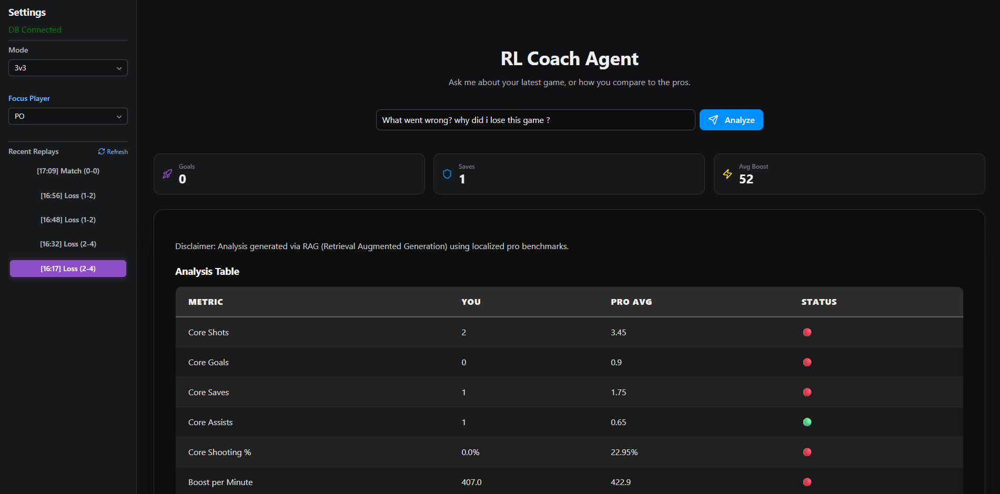
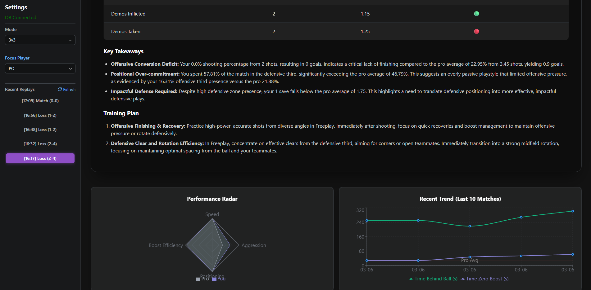

# 🏎️ RL Coach Agent : analyse de performance Rocket League avec RAG

> **EN:** An AI coaching assistant for Rocket League. It stores match metrics in PostgreSQL, compares them to pro-player benchmarks built from the Ballchasing API, and generates a diagnostic with Gemini based only on the retrieved data (RAG, pydantic-ai, Reflex, PostgreSQL).

Système de coaching qui analyse tes replays de matchs Rocket League et génère un diagnostic **basé uniquement sur des données vérifiables**, pour limiter les hallucinations du modèle.

## 📸 Aperçu





🎥 [Voir la démo vidéo](https://www.youtube.com/watch?v=XF85Hh900gc)

## 🧠 Architecture : pourquoi du RAG ?

Un modèle de langage seul invente facilement des conseils généraux. Ici, il s'appuie sur des données locales et vérifiables (RAG : Retrieval Augmented Generation). L'agent (pydantic-ai + Gemini 2.5 Flash) dispose de deux outils :

1. **`get_last_match_metrics`** : lit en base PostgreSQL les métriques du dernier match (boost, mouvement, positionnement, etc.), filtrées par mode de jeu.
2. **`get_comparison_data`** : charge les benchmarks de joueurs pros du bon mode (2v2 ou 3v3) pour comparer.

Le prompt système impose de ne s'appuyer que sur ces données : une métrique absente est signalée « Data unavailable » au lieu d'être inventée. Le diagnostic contient un tableau comparatif, 3 points clés maximum et 2 exercices de Freeplay.

**Flux de données :**

```
Replay (.replay)
   │  watcher (watchdog) → upload sur l'API Ballchasing
   ▼
Statistiques du match (JSON Ballchasing)
   │  insertion
   ▼
PostgreSQL : table player_stats ──► agent Gemini (RAG) ──► diagnostic
                                        ▲
                       benchmarks pros (data/benchmarks/{2v2,3v3})
```

## 🚀 Fonctionnalités

- **Filtrage par mode de jeu** : métriques et benchmarks isolés par mode (2v2, 3v3).
- **Visualisations** : radar comparatif et courbe de progression dans le temps.
- **Ingestion automatique** : un script « watcher » détecte les nouveaux fichiers de replay et les charge en base.
- **Score de similarité** avec les profils de joueurs pros (distance euclidienne normalisée sur trois axes : efficacité du boost, vitesse et agressivité, positionnement).
- **Entraînement ciblé** : exercices de Freeplay générés à partir des écarts détectés.
- **Interface sombre et minimaliste**, pensée pour une revue rapide après un match.

## 🛠️ Stack technique

| Couche | Outils |
|---|---|
| IA / LLM | Gemini 2.5 Flash via pydantic-ai (agent avec outils) |
| Interface | Reflex (framework Python full-stack), graphiques Recharts intégrés à Reflex |
| Base de données | PostgreSQL 16 (Docker), psycopg2 |
| Données de replays | API Ballchasing |
| Surveillance de fichiers | watchdog |
| Gestion des paquets | uv |

## ⚙️ Installation

**Prérequis** : Docker et Docker Compose, Python 3.12+, [uv](https://docs.astral.sh/uv/), une clé API Gemini, une clé API Ballchasing, et Rocket League installé (pour surveiller ton dossier de replays).

1. **Cloner le dépôt**
   ```bash
   git clone https://github.com/pierreolivierbinet/rl-coach-agent.git
   cd rl-coach-agent
   ```
2. **Configurer l'environnement** : copie `.env.example` en `.env` et renseigne au minimum `GEMINI_API_KEY`, `BALLCHASING_API_KEY`, `PLAYER_NAME` (ton pseudo en jeu) et `REPLAY_DIR` (dossier des replays Rocket League).
3. **Démarrer la base de données**
   ```bash
   docker compose up -d
   ```
4. **Créer la table des statistiques**
   ```bash
   uv run python src/database/init_db.py
   ```
5. **Démarrer le watcher de replays** (dans un terminal)
   ```bash
   uv run python src/tools/replay_watcher.py
   ```
6. **Démarrer l'interface** (dans un autre terminal)
   ```bash
   uv run reflex run
   ```

`uv` installe les dépendances au premier lancement.

## 📊 Données et benchmarks

Les benchmarks pros sont dans `data/benchmarks/{2v2,3v3}/pro_reference_data.json`. Ils sont générés par `src/tools/fetch_pro_benchmarks.py` à partir des statistiques de groupes de replays pros de l'API Ballchasing (moyennes par match et par joueur) :

| Mode | Source | Joueurs |
|---|---|---|
| 2v2 | 5 groupes de matchs pros | 106 |
| 3v3 | groupe « Boston Major » | 39 |

Fichiers générés le 6 mars 2026. Pour les régénérer : renseigne `PRO_2V2_IDS` / `PRO_3V3_IDS` dans `.env`, puis `uv run src/tools/fetch_pro_benchmarks.py --mode 2v2` (ou `3v3`).

## ⚠️ Limites

- Les benchmarks sont une photographie à une date donnée, pas mis à jour automatiquement.
- L'analyse dépend de services externes : l'API Ballchasing pour les replays et Gemini pour la génération.
- Projet pensé pour un usage personnel (un joueur, configuré via `PLAYER_NAME`).
- Pas de tests automatisés dans le dépôt pour l'instant.

## 👤 Auteur

**Pierre-Olivier Binet** : Master 2 Data Analytics (Ingémédia, Université de Toulon). Ancien joueur professionnel de Rocket League (2x champion de France).
[LinkedIn](https://www.linkedin.com/in/pierre-olivier-binet/) · [Portfolio](https://portfolio-pierreolivier-binet.netlify.app) · pierro.bnt@gmail.com
